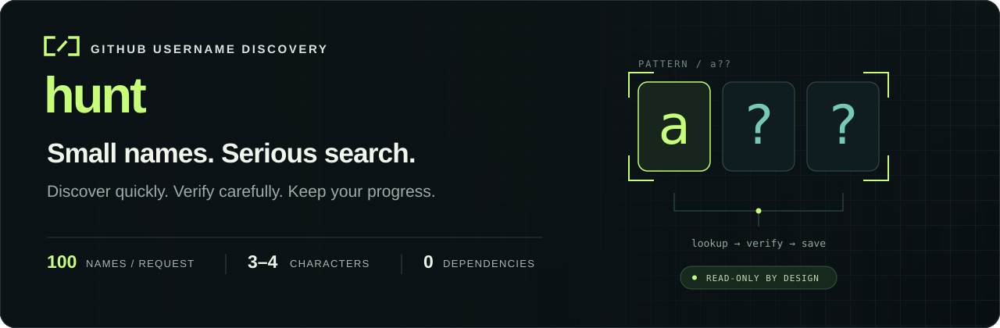
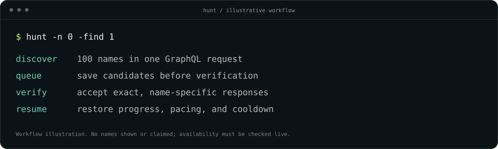

<p align="center">
  
</p>

<p align="center">
  <strong>Batched discovery · Live verification · Durable resume</strong><br>
  A focused Go CLI for finding three- and four-character GitHub usernames.
</p>

<p align="center">
  <a href="https://github.com/guike8/hunt/actions/workflows/ci.yml"></a>
  <a href="https://github.com/guike8/hunt/releases/latest"></a>
  <a href="LICENSE"></a>
</p>

<p align="center">
  <a href="#quick-start">Quick start</a> ·
  <a href="#choose-your-search">Search options</a> ·
  <a href="#results-you-can-interpret">Result semantics</a> ·
  <a href="COMPARISON.md">Benchmarks &amp; comparison</a>
</p>

<p align="center">
  
</p>

## Quick start

Requires **Go 1.22+**, plus a GitHub token or an active [GitHub CLI](https://cli.github.com/) login. The Go code uses only the standard library.

Prefer a ready-to-run binary? [Download the latest release](https://github.com/guike8/hunt/releases/latest) for macOS, Linux, or Windows. Archives include SHA-256 checksums on the release page.

```sh
git clone https://github.com/guike8/hunt.git
cd hunt
go run . -n 0 -find 1
```

This searches the full three-letter space, verifies candidates as they arrive, and stops after the first explicitly available name. An available name may not exist in your selected space.

Already signed in with `gh`? Hunt uses that login automatically. Otherwise, run `gh auth login --hostname github.com`, or set `GH_TOKEN` / `GITHUB_TOKEN` in your environment. Tokens are never written to results.

To build a local binary:

```sh
go build -o hunt .
./hunt -n 0 -find 1
```

## Why hunt

| Capability | What it gives you |
| --- | --- |
| **100 names per request** | GraphQL lookup batches cover both personal and organization names. |
| **Verification starts immediately** | A bounded queue feeds candidates into GitHub's public validator while discovery continues. |
| **First result or full search** | Stop at one or N verified results, or finish the selected space. |
| **Progress stays on disk** | Durable journals preserve observations, pending candidates, pacing, and cooldowns. |
| **Focused inputs** | Ordered wordlists, `?` patterns, optional digits, and deterministic generation. |
| **Zero third-party Go modules** | A small codebase you can read, test, and build yourself. |

## Choose your search

```sh
# First five verified available names:
go run . -n 0 -find 5 >> available.txt

# Fast discovery only; stdout contains unverified candidates:
go run . -n 0 >> candidates.txt

# Target a pattern (? matches one character):
go run . -pattern 'a??' -n 0 -find 1 -out a-names.jsonl -verify-out a-verified.jsonl

# Preserve your wordlist's order; normalize case and remove duplicates:
go run . -input names.txt -n 0 -find 1 -out words.jsonl -verify-out words-verified.jsonl

# Four letters, with a separate journal:
go run . -length 4 -n 1000 -out four.jsonl >> four.txt

# Three characters including digits:
go run . -digits -n 1000 -out digits.jsonl >> digits.txt

# Verify every candidate while discovery continues:
go run . -n 0 -live-verify >> available.txt
```

Wordlists must match the selected length and character set. Generated names use a deterministic shuffle; patterns expand directly. Source hashes, patterns, alphabet, length, and seed are bound to the journal, so incompatible inputs cannot silently reuse progress.

Use `go run . -help` for every option. `-n` limits names checked in an invocation; `-n 0` selects all remaining names.

## Results you can interpret

| Result | Meaning |
| --- | --- |
| `taken` | GitHub returned a visible personal or organization owner. |
| `candidate` | No visible owner was returned. The name still needs verification. |
| `available` | GitHub's signup validator explicitly accepted that exact name at the recorded time. |
| `unavailable` | The validator explicitly rejected that exact name. |
| Unknown or error | No availability claim is made. Transient failures receive bounded retries; schema, authentication, and rate-limit failures stop requests. |

**Discovery-only stdout contains candidates.** With `-find`, `-live-verify`, or `-verify`, stdout contains verified available names. Diagnostics go to stderr; JSONL journals retain the timestamped observations.

Verify a saved list or discovery journal without API authentication:

```sh
go run . -verify candidates.txt -verify-out verified.jsonl >> available.txt
# Or:
go run . -verify results.jsonl -verify-out verified.jsonl >> available.txt
```

A null owner can be a reserved or restricted name. Availability can change immediately and does not reserve anything. Hunt makes read-only lookup and validation requests; it does not open a browser, create an account, or change a username.

## Stop and continue

Press **Ctrl-C**, then repeat the same command to resume. Discovery skips completed checks and replays pending candidates first. Use `>>` when retaining prior text output; the journals hold the authoritative history.

Both journals use exclusive operating-system locks. A process exit releases its lock automatically; leftover `.lock` files are harmless. Completed batches are synced before candidates are published. Torn final writes after a valid record recover; committed corruption and unrecognized files are rejected.

Verification keeps negative observations for 24 hours and positive ones for 30 seconds. Fresh cached positives may be emitted again, with their original check time in stderr. To explicitly recheck observations while preserving history:

```sh
go run . -fresh -n 0 -find 1
go run . -fresh -verify results.jsonl >> available.txt
```

`-fresh` rechecks selected names on each invocation; omit it for normal resume. It preserves request spacing and cooldowns.

## Request pacing

Discovery starts GraphQL requests at least one second apart. A complete three-letter scan covers **17,576 combinations in 176 successful full-size requests**.

Verification starts requests at least seven seconds apart. That stage is usually the bottleneck when many candidates need checking. Rate cooldowns and request timing persist across restarts. Hunt does not rotate proxies or copy browser cookies.

The signup validator is undocumented and can change. Unknown responses stop verification; GraphQL discovery remains independent of it. No search duration or available name is guaranteed.

## Measured performance

A fixed live test checked the same 20 names with matching classifications:

| Method | Requests | Elapsed |
| --- | ---: | ---: |
| Serial REST baseline, one-second start cadence | 20 | 19.23 s |
| One GraphQL batch | 1 | 0.77 s |

The result describes that workload and its deliberately paced baseline. No competing executable was benchmarked, and it is not a universal speed claim.

See the [11-repository comparison](COMPARISON.md), [raw microbenchmarks](benchmark-results.txt), and [live test data](live-benchmark.json). All implementation code was written independently.

## Development

```sh
go test -race ./...
go vet ./...
go test -run '^$' -bench . -benchmem
```

Builds are checked for macOS, Linux, and Windows; runtime tests run on macOS. Tests cover classification, cancellation, bounded retries, partial responses, refresh, journal recovery, cross-process locking, and resumable verification.

`make build VERSION=v0.1.0` builds a compact local binary. `make release VERSION=v0.1.0` creates six deterministic platform archives and a checksum manifest using Python's standard library. CI tests macOS, Linux, Windows, and the minimum Go version.

Released under the [MIT license](LICENSE).
